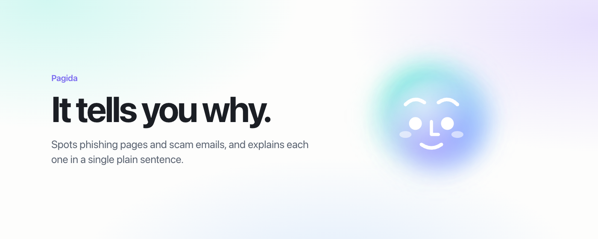
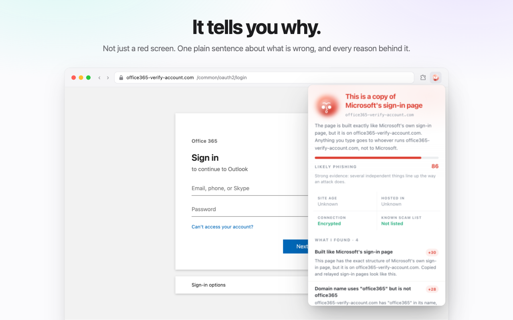
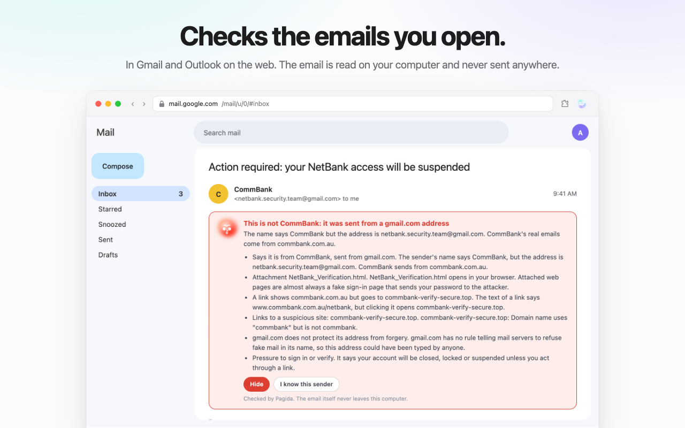
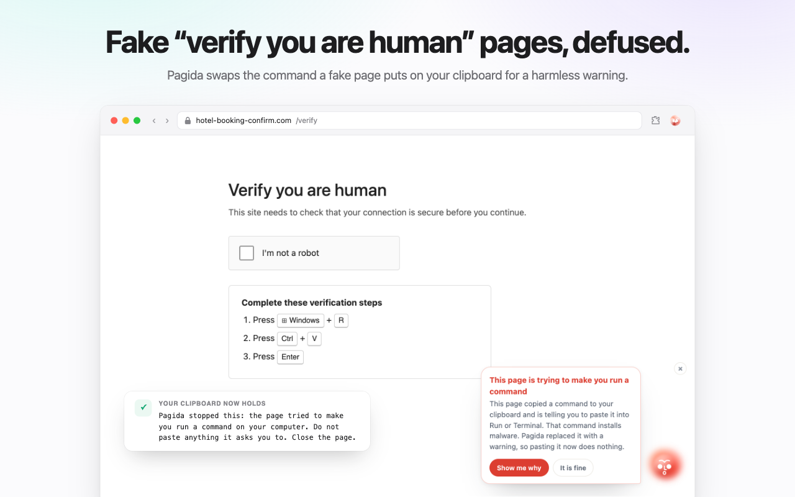
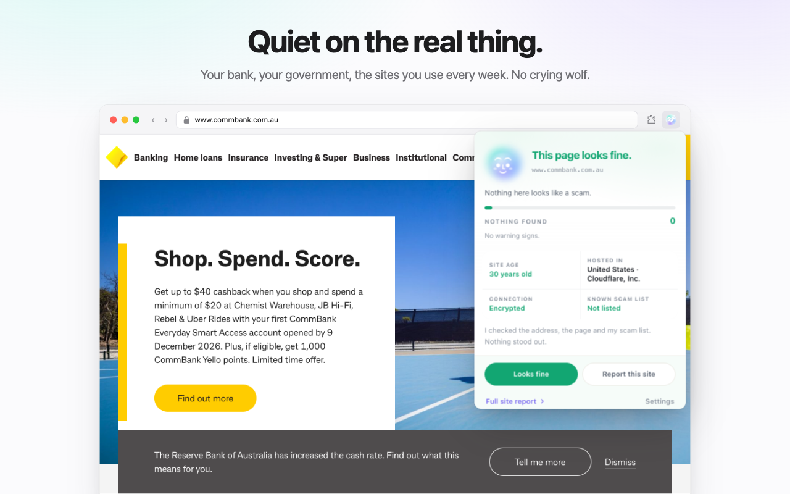
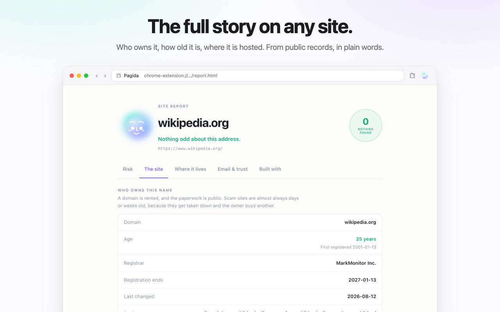
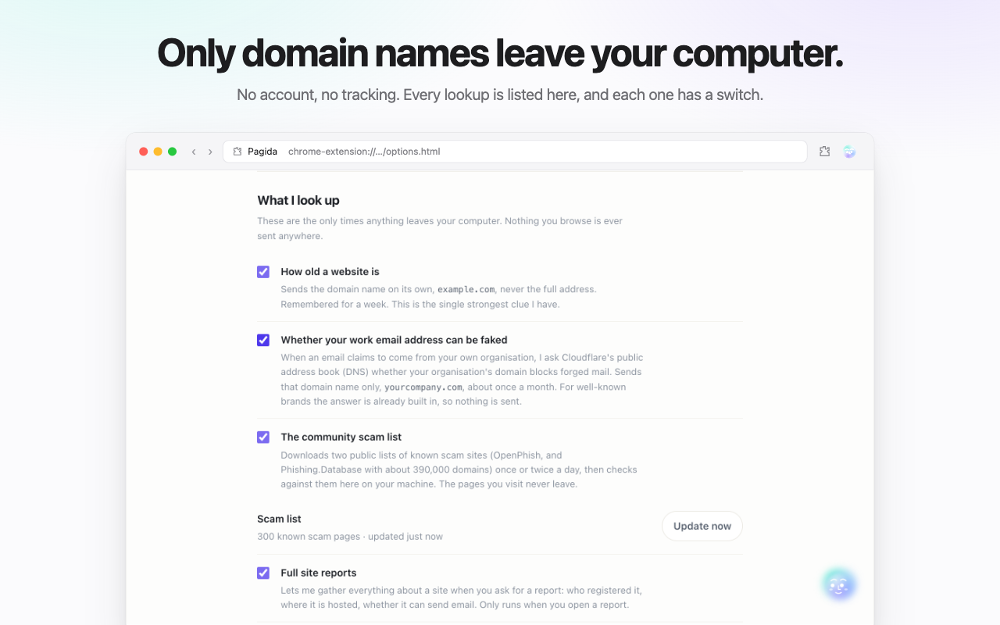

<div align="center">



# Pagida

**A free phishing detector for Chrome and Edge that tells you why.**

[](https://github.com/AryannDhingraa/pagida/actions/workflows/ci.yml)
[](LICENSE)
[](src/manifest.json)
[](test)

*παγίδα is Greek for "trap".*

**[Get it on the Chrome Web Store](https://chromewebstore.google.com/detail/bcjboonbeegdjfcgijbbeccpcighafll)** · [What's new](CHANGELOG.md) · [Privacy](https://aryanndhingraa.github.io/pagida/privacy.html)

</div>

---

## Why I made this

Most scam warnings are a red screen that says "trust me". People click straight
past them, because nothing on the screen tells them what is actually wrong.

So Pagida has one rule. If it warns you, it has to say why, in one sentence a
normal person would understand. "This is a copy of Microsoft's sign-in page,
but it's on office365-verify-account.com." Then it shows every reason behind
that sentence, so you can check it yourself. After a while you start spotting
the same tricks on your own, which is kind of the point.

It checks the pages you open and the emails you read in Gmail and Outlook on
the web. It all runs on your computer. No account, no tracking, and it keeps
working offline.

Iris is the little face in your toolbar. She stays calm when a page is fine and
changes colour when it isn't: blue for "worth a look", amber for "suspicious",
red for "likely phishing". You get the answer before you've read a word.

## What it looks like

Every one of these is the real extension running, not a mock-up.

<div align="center">

<br><br>

<br><br>

<br><br>

<br><br>

<br><br>

</div>

## What it catches

- **Fake sign-in pages.** Copies of bank, email and shopping logins sitting on
  a domain the brand doesn't own. That includes copies of the sites *you* sign
  in to, which it learns as you go.
- **Scam emails.** In Gmail and Outlook on the web it checks who really sent the
  email, where the links actually go (not where they say they go), QR codes,
  attachments that are secretly web pages or programs, and what the email wants
  from you. A changed bank account, a "full mailbox", a gift card, a phone call
  about a charge you never made.
- **Fake "verify you are human" pages.** The newest trick puts a malware command
  on your clipboard and asks you to paste it into your computer. Pagida swaps
  that command for a harmless warning, so pasting it does nothing.
- **The rest of the usual stuff.** Fake virus warnings, fake pop-up login
  windows, pages after your crypto recovery phrase, pages that post your
  password to a Telegram bot, lookalike addresses like `paypa1.com`, and
  domains registered a few days ago.
- **Known scam sites.** Two public scam lists, downloaded and checked on your
  own computer, plus Google's threat list for sites that aren't well known.

## How it decides

Lots of small checks run on every page, and each one adds a bit of suspicion.
But adding up points isn't enough to call something phishing. To say "Likely
phishing", Pagida needs a reason it can put in one sentence. That rule is what
keeps false alarms rare, and it's why every warning you see comes with an
explanation attached.

There are two small trained models in there as well, one for pages and one for
emails. They read the text on your computer and nudge the score. They never
make the call on their own.

## The full site report

One click from the popup, or right-click any link and choose **Ask Iris about
this link** to check it without opening it. The report tells you what a site
actually is:

- who registered the domain, when, and when it runs out
- where it's hosted, on whose network, in which country
- its public certificate history, and whether the Internet Archive has seen it
- whether it can send email, and whether its address can be faked
- what it's built with and what else runs on the same machine

Every answer comes from a free public source, and the report names them all at
the bottom.

## Does it work?

I test every release against live phishing, real websites and real emails, and
publish the results, false alarms included.

- **101 live phishing pages:** 68% flagged Suspicious or worse.
- **353 real websites:** none called Likely phishing, and only 2 called Suspicious.
- **2025 phishing emails:** 75.7% warned, with 1 false warning in 844 normal emails.
- **Speed:** a verdict in about 0.15 seconds.

The full method is in [EVALUATION.md](EVALUATION.md).

## Privacy

No account. No sign-in. No analytics. No ads. Nothing sold to anyone.

The checks run on your computer. The only things that ever go online are
**domain names**, like `example.com`. Never the address of the page you're on,
and never anything from your emails:

- **Google's threat list**, through a small server I run so you don't need a
  key. It gets the domain only, it's never asked about the world's best-known
  sites, and it keeps nothing about you.
- **How old a domain is**, from the public domain registries.
- **Whether an email sender's domain can be faked**, from public DNS.
- **The two scam lists**, downloaded a couple of times a day and matched locally.

Every one of these has its own switch in Settings. Turn them all off and
Pagida still works. The long version, source by source, is in
[PRIVACY.md](PRIVACY.md).

## Install

**Chrome:** [Pagida on the Chrome Web Store](https://chromewebstore.google.com/detail/bcjboonbeegdjfcgijbbeccpcighafll).
It works in Edge too: open that link in Edge and allow extensions from other
stores.

**From source:**

```bash
git clone https://github.com/AryannDhingraa/pagida.git
cd pagida
npm install
npm run build
```

Then go to `chrome://extensions`, turn on **Developer mode**, click **Load
unpacked** and pick the `dist` folder.

## For companies

IT can push Pagida to every managed Chrome or Edge with the
`ExtensionInstallForcelist` policy and set it up through the extension's own
policy (`managed-schema.json`). Anything set there shows as "Set by your
organisation" in Settings.

```json
{
  "settings": { "checkEmail": true, "usePagidaService": true, "rememberSignIns": true },
  "orgDomains": ["acme.com.au", "acme-group.net"]
}
```

`orgDomains` is the company's own domains, so internal tools on odd-looking
addresses and mail from a second company domain don't set off false alarms.
Known scam lists still apply to them.

## For developers

```
src/
├── core/        the web engine, pure TypeScript, no browser APIs
├── email/       the email engine, same rule
├── learned/     the two text models and their tokenizer
├── content/     page/ runs on every site, mail/ only on Gmail and Outlook
├── background/  the service worker
├── services/    scam lists, domain age, the Pagida service, QR codes, reports
├── ui/          Iris
└── popup/ options/ report/
```

The engines have no browser APIs on purpose. That way the tests and the
evaluation scripts run the exact code people install.
[ARCHITECTURE.md](ARCHITECTURE.md) has the full map.

```bash
npm test             # 289 unit tests
npm run typecheck
npm run lint
npm run build        # dist/
npm run try          # a separate test browser with every test page, service off
npm run zip          # the package for the stores
```

`tools/harness/` has the rest: side-by-side comparisons on real sites, local
attack pages, mock Gmail and Outlook, and the scripts that make the store
screenshots from the real build.

Found a bug, or a scam Pagida should have caught? [Open an issue](https://github.com/AryannDhingraa/pagida/issues).
If it's a security problem in Pagida itself, please read [SECURITY.md](SECURITY.md)
first. Pull requests are welcome, see [CONTRIBUTING.md](CONTRIBUTING.md).

## Credits and licence

MIT © Aryan Dhingra.

Scam lists from the [OpenPhish community feed](https://github.com/openphish/public_feed)
and [Phishing.Database](https://github.com/Phishing-Database/Phishing.Database).
Domain registration data via [RDAP](https://rdap.org).

The text models were trained on the
[Nazario phishing corpus](https://monkey.org/~jose/phishing/) (CC BY 4.0, by
Jose Nazario), the [SpamAssassin public corpus](https://spamassassin.apache.org/old/publiccorpus/)
and [ealvaradob/phishing-dataset](https://huggingface.co/datasets/ealvaradob/phishing-dataset)
(Apache-2.0). The weights in `src/learned/data` are derived from them.
